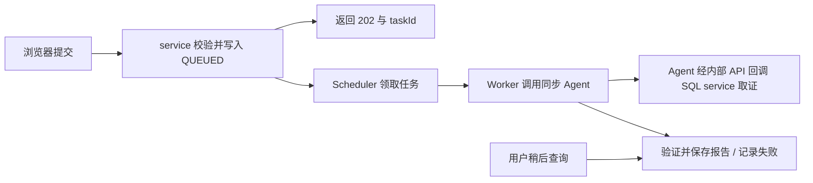

# SQL 优化器：后端实施方案

日期：2026-10-13。状态：待实施。负责 worktree：`feat/sql-optimizer-backend`。

先读 [共享契约 v1](sql-optimizer-api-contract.md) 与 [并行实施入口](plan-sql-optimizer-async-tasks.md)。本分支拥有 `service/**`，不修改 `web/**`。前端按契约独立开发，不等待本分支完成。

## 后端目标与边界

交付四个持久任务 API、数据库队列、独立 Worker、Agent 同步客户端、报告校验/存储、短期用户凭证、权限/幂等/配额、重启恢复和维护。Agent ID 固定 sql-lite-optimizer；不增加 Agent 任务 API，不复制 Agent Loop，不执行原 SQL 或优化建议。

使用当前 Spring Boot 2.7.18 / Java 8 / MVC / MyBatis / Flyway / MySQL。DTO 使用 Java 8 兼容类。数据库迁移在实施时选下一个可用版本。后端运行地址/凭证/调用预算配置在 service；浏览器不直连 Agent。

建议文件：`optimization/{SqlOptimizationController,SqlOptimizationService,SqlOptimizationScheduler,SqlOptimizationWorker,SqlLiteAgentClient,OptimizationReportValidator}.java`、`optimization/api/`、`optimization/persistence/`、`mappers/SqlOptimizationMapper.xml`、`db/migration/V<next>__create_sql_optimization_task.sql`。

## BE-01：契约与最小 Agent 接入

- [ ] 按共享契约定义任务/报告 DTO、状态、业务错误映射；列表/详情的字段名与空值必须一致。
- [ ] 实现固定 SQL Lite 同步客户端与 message 坐标组装，不从 message 提取报告。
- [ ] 用 stub/HTTP fixture 验证 successful structuredOutput、401、5xx、超时与非法报告。
- [ ] 确认生产 CurrentUserPort 与用户 Bearer 回调路径；Agent 项目或部署层没有提供时记录为真实联调依赖，先继续实现本地/Stub 闭环，不绕过认证。

以下 Agent 事实来自代码阅读，不是待新增接口：

### 已确认的接入契约与限制

| 项目 | 当前事实 | 对 web-editor 的影响 |
| --- | --- | --- |
| Agent ID | `sql-lite-optimizer` | 由后端固定，前端不得提交任意 agentId |
| 同步入口 | `POST /api/v1/agents/sql-lite-optimizer/chat` | Worker 调用该接口 |
| 请求 | `sessionId`、`message` 必填 | 每次分析使用新的 sessionId；message 必须包含数据源坐标和完整 SQL |
| 报告 | 响应的 `structuredOutput` 是 `SqlLiteOptimizationReport` | 直接读取此字段，不从 message 或 Markdown 中提取 JSON |
| 流式入口 | 仍是既有文本事件协议 | 不用于首版报告持久化或百分比进度 |
| 一次性分析 | 不依赖此前上下文 | 每次重扫新建任务；重试 attempt 使用新的 sessionId |
| 只读工具 | 数据源信息、库表定位、SQL 校验、EXPLAIN、表结构、表关系，共七个工具 | 不挂载 `execute_query`，不执行原始业务查询或建议 SQL |
| 规则范围 | Prompt 纳入/条件性纳入 17 条组织规则，并非全部 45 条源规则 | UI 不宣称完整规则覆盖；未定义的清单/阈值会成为 limitations |
| 时间预算 | 当前全请求 120s，模型单次 60s，Agent max-iters=12 | 异步不会自动延长 Agent 预算；超时必须落为可解释的失败 |
| 输入上限 | 平台消息 65536 字符，数据源工具 SQL 20000 字符 | 首版 SQL 最长 20000 字符，同时校验组装后的消息长度 |
| 会话存储 | 平台仍持久化会话状态，releaseSession 仅清缓存 | 不能宣称“一次性调用后不留状态”；另行制定 Agent 状态保留策略 |
| 正式身份 | 仓库内目前仅 HeaderCurrentUserAdapter，默认关闭，dev/test 才开放 | 生产上线须确认真实 CurrentUserPort 已在部署层接入；仅 Bearer 请求默认不能通过当前适配器 |

重要实现细节：通用 `AgentApplicationService` 只对 `sql-editor` 自动组装编辑器上下文。调用 SQL Lite 时，即使请求包含 `datasourceId` / `database` 字段，平台也不会替它们拼入 message。必须由本项目后端显式组装：

```http
POST /api/v1/agents/sql-lite-optimizer/chat
Authorization: Bearer <当前 attempt 的用户凭证>
X-Request-Id: <attemptRequestId>
Content-Type: application/json

{
  "sessionId": "<服务端生成的 attempt UUID>",
  "message": "datasourceId: <datasourceId>\ndatabase: <namespace>\n<完整 SQL>"
}
```

坐标字段拒绝 CR/LF 等控制字符，避免拼接时引入额外坐标行；SQL 原文完整保留。开发环境可由后端加入已验证用户的 `X-User-Id`，生产不能把开发 Header 身份当正式认证。

## BE-02：数据库与 API

- [ ] 创建任务、attempt、短期凭证表与索引；报告保存快照，记录 reportSchemaVersion=1。
- [ ] 按共享契约实现创建/列表/详情/重扫，创建返回 202 + Location。
- [ ] 幂等 lookup 与请求指纹检查先于重复创建配额扣减；指纹包括操作及 retry 原任务 ID。
- [ ] 参数校验、引擎只读单 SQL 校验、坐标控制字符拒绝；database 首版非空，沿用 editor namespace。
- [ ] 查询始终按 userId/productId 过滤并实时校验数据源可见性；越权与不存在统一 404。
- [ ] 配额检查/插入在可防竞态的事务范围中完成；游标绑定身份、过滤和稳定排序。

## BE-03：队列、Worker 与恢复

- [ ] 独立 Worker 执行池，不混用 sqlExecutionExecutor；先取得本地槽再原子领取。
- [ ] 短事务保存 attempt，事务外调用 Agent；心跳和结果写入按 current_attempt_id / status 条件约束。
- [ ] 心跳续 lease 时不修改领取时捕获的任务 version，或在完成写入时重新读取版本；不能让自己的心跳导致结果 CAS 必然失败。
- [ ] QUEUED 重启恢复，过期 RUNNING 落 WORKER_LOST，旧 attempt 迟到结果不覆盖终态。
- [ ] 首版无已发出 POST 自动重试，用户重扫新建任务和 sessionId。

下面是存储与调度设计；其内部字段可演进，对外状态与 DTO 以共享契约为准：

### 数据与可靠执行设计

#### 存储

建议使用现有元数据库新增 `sql_optimization_task` 和 `sql_optimization_attempt`，不借用执行历史表。任务是用户可见的业务对象，attempt 是一次 Agent HTTP 分析，sessionId 是该 attempt 的 Agent 会话，三者不可互相替代。

任务表主要字段：

| 分组 | 字段 |
| --- | --- |
| 身份与输入 | id、user_id、product_id、name、data_source_id、data_source_name、engine_id、database_name、statement_text、statement_sha256、source_task_id |
| 幂等与状态 | idempotency_key、request_fingerprint、status、current_attempt_id、version |
| 报告 | report_schema_version、report_json、policy_issue_count、performance_issue_count、limitation_count |
| 生命周期 | created_at、started_at、completed_at、expires_at、error_code、error_message、request_id |

attempt 表主要字段：id、task_id、attempt_no、session_id、request_id、worker_id、lease_until、started_at、completed_at、outcome、error_code。凭证密文放单独的短期凭证表，不放报告 JSON 或普通 task DTO。

报告 JSON 首版可用 MEDIUMTEXT，经 Jackson DTO 校验后写入；不预先拆分 issues 等明细表。输入 SQL 与报告保持快照，不随用户编辑脚本而改变。数据源名称/引擎快照仅用于展示，权限与实际连接始终查实时数据源。

索引至少覆盖 `(user_id, product_id, created_at, id)`、`(status, created_at, id)`、attempt 的 lease 过期查询及 `(task_id, attempt_no)` 唯一键。时间按现有 UTC 存储，API 返回 ISO 8601。

建议任务/报告默认保留 90 天、SQL/报告原文不进常规日志、输出大小上限初始 1 MiB；超限记录 REPORT_TOO_LARGE，不截断成看似完整的报告。保留值需按实际 SQL 敏感性与容量确认后配置。

#### 调度与状态机



业务状态只有 `QUEUED → RUNNING → SUCCEEDED / FAILED`。无问题、有限证据都是 SUCCEEDED + 对应报告；无结构化结果、HTTP/认证失败、超时等为 FAILED。原任务终态不可被迟到结果覆盖。

首版数据库就是持久队列，Scheduler 周期性扫描，不引入 MQ。不要只在 Controller 里 `@Async` 或 submit 到内存队列后就返回成功，否则进程重启会丢任务。

推荐执行步骤：

1. 创建事务内校验配额、写任务和短期凭证，事务提交后返回 202。
2. Worker 先获得本地执行槽，再用带 status/version 条件的 UPDATE 原子领取一个 QUEUED 任务；只有 affectedRows=1 才可执行。事务内建立 attempt 和 lease，然后立即释放事务/连接。
3. 恢复该任务凭证，向授权服务重新校验，核对 userId/productId 与任务一致，并重新验证数据源可见性。不能在后台线程直接调用依赖请求 ThreadLocal 的 `CurrentAuth.get()`；显式传递重新校验后的 AuthContext。
4. 用新 attempt sessionId 调 Agent；HTTP 等待期间不持有元数据库事务，独立心跳续租。
5. DTO 验证后，在短事务中按 taskId + current_attempt_id + RUNNING + version 条件保存报告并切到 SUCCEEDED；失败同样条件落 FAILED。
6. 删除短期凭证；扫描器回收过期凭证与历史任务。

建议起始值：调度间隔 2s、Worker 并发 2、用户未完成任务上限 10、全局上限 100；配额通过事务/专用计数行串行化，不能仅在 Controller 中先 COUNT 再 INSERT。目标 SQL 数据库并发配额与优化任务配额是两层限制。

Agent 服务会回调同一 SQL service，必须保留独立 HTTP 请求处理和数据库工具执行容量，防止 Worker 占满既有执行线程导致回调等待、循环饥饿。

#### 超时、恢复与重复执行

建议 Agent client 连接超时 3s、整个 HTTP 调用上限 135s、attempt 硬预算 150s、lease 180s、心跳间隔 15s。这些是初始值，需与实际平台 120s 预算及网关 timeout 联动；心跳不得无限续租超过硬预算。

进程重启后 QUEUED 任务由数据库重新发现。RUNNING lease 过期统一 FAILED / WORKER_LOST，首版不自动重试已发出的 Agent 调用，以免制造重复 LLM 成本。用户可用新凭证“再次扫描”；无输出或响应丢失的任务不能推断上游从未执行。

领取后宕机、网络分区、上游在客户端超时后继续计算，都可能发生。条件写入只能保证最终任务结果不被旧 attempt 覆盖，不能保证 Agent HTTP exactly-once。HTTP 中断也不能承诺上游立即停止取证。

若将来增加自动重试，须限定错误分类、最大次数、退避、成本预算，并每次使用新 sessionId；不得在 retry middleware 内透明重发已经发送的 POST。

## BE-04：凭证、权限与开关

- [ ] 实施短期 Token 加密托管、独立密钥/purpose、到期检查、终态及到期清理。
- [ ] Worker 重新授权并显式传 AuthContext，不在后台使用请求线程的 CurrentAuth.get()。
- [ ] 将 SQL_OPTIMIZE 纳入 SessionResponse 与后端 API 校验；功能未开启不授予能力，授予用户范围必须明确。
- [ ] 调通 Agent → SQL service 的 Bearer + 可选内部 key；内部 key 不替代用户。
- [ ] 真实生产身份外部依赖未满足时不开生产功能，前端 Mock 开发不受影响。

### 后台授权：上线前必须定清的依赖

#### 当前链路

`SQL service Worker → Agent → SQL service /internal/api/v1/agent/*`。

Agent `DatasourceClient` 回调时发送用户 `Authorization: Bearer ...`，可额外发送 `X-Internal-Service-Key`。本项目 `AuthContextFilter` 同样验证内部 Agent API 的用户 Token；内部服务 key 只证明调用来源，不能替代最终用户或产品权限。

本项目 `AuthContext` 有 tokenExpiresAt，但没有凭证续期/委派接口；Agent 仓库内也没有现成生产 Bearer 身份适配器。两者均不能在方案里当作已实现能力。

#### 推荐首版：短时、显式到期的凭证托管

为避免进程重启后排队任务失去凭证，首版需将创建请求中**已验证**的用户 Token 加密保存为短期任务凭证；密钥来自服务端安全配置，使用带认证的加密、独立 purpose/key version，不直接假设现有数据库密码加密器适合 Token。

- 有效期取 Token 实际到期时间与可配置任务凭证 TTL 的较早者，TTL 初始建议 10 分钟；不可保存明文，也不可落日志、报告或返回浏览器。
- 创建/领取时需预留整个 attempt 的时间余量；Token 已近到期则提示重新登录后提交，不接受明知无法执行的任务。
- Worker 开始前重新调用授权服务，不仅信任提交时 AuthContext 或本地缓存。执行中工具调用也由服务端逐次/按现有认证策略重新授权。
- Token 过期/撤销/产品变化、凭证密钥不可用等落 FAILED，并提示“重新登录后再次扫描”。若上游工具将认证失败作为 limitations 返回报告，也必须保留缺口，不展示全绿。
- 终态立即清理密文；创建事务失败不残留凭证；定时回收过期 QUEUED 凭证并将任务置 FAILED / CREDENTIAL_EXPIRED。
- 关闭页面通常不撤销 Token，因此可继续执行；显式退出可能撤销授权服务 Token，后续分析不保证完成。已经生成的报告仍可在重新登录并通过任务读权限后查看。

若项目不接受短期 Token 落库，应将首版替换为内存凭证模式并明确重启后任务失败，或先建设下一节的委派凭证；不能一面不保存任何后台凭证，一面承诺任务在重启后继续执行。

#### 更长期的无人值守任务

若要求“排队数小时、退出后仍继续、定时/批量扫描”，推荐授权服务新增短期、可撤销的任务委派凭证，绑定 user/product/task/datasource、只读能力与有效期。此项是**授权服务及内部 API 的额外开发**，当前不具备。

Agent 的生产 CurrentUserPort 必须识别正式用户/委派凭证并传播可用于数据源回调的 BearerCredential；SQL service 必须验证同一权限主体。不得把应用服务账号当所有用户运行，也不得接受裸 userId/productId 代替身份。

#### 权限与联调配置

任务读写均限定当前 userId + productId；详情及报告读取额外校验数据源仍可见。用户跨产品、数据源删除/不可见时返回统一 404，不能仅靠任务创建时的快照授予永久数据访问。维护清理走后台维护职责。

建议新增 `SQL_OPTIMIZE` capability，并同步 `SessionResponse`、前端 capability 类型/导航与后端校验；当前 SessionResponse 是静态能力列表，新增字符串本身不等于真实权限体系，首版须明确其授予规则。

Agent 侧显式启用 DATASOURCE_SERVICE_ENABLED 并指向本项目服务，核对内部 API 路径和内部 caller key 配对。SQL Lite 不需要打开 DATASOURCE_QUERY_ENABLED。Agent 基础配置默认关闭数据源集成，部署后必须检查，不能靠收到 HTTP 200 推断已取到证据。

部署前确认生产身份适配器在哪里提供；如果外部部署没有提供，应作为独立的认证接入工作处理，不修改 SQL Lite Provider 或核心 Executor 来绕过认证。

## BE-05：报告边界与维护

- [ ] 对 structuredOutput 做格式、枚举、ID 和 issueIds 引用校验，不裁决 SQL/模型证据真伪。
- [ ] 服务端从报告派生 summary，仅 SUCCEEDED 返回 report/schemaVersion/summary；失败返回 error。
- [ ] 输出超限、报告非法落 FAILED，不截断、不散文 fallback、不补造字段。
- [ ] 清理过期 task/attempt/凭证，SQL/Token/完整报告不写常规日志。
- [ ] 不把 Agent releaseSession 当状态删除；Agent 状态保留策略作为部署同步项。

### 报告契约与入库校验

DTO 对齐上游：

```ts
type OptimizationReport = {
  verdict: string
  issues: Array<{
    id: string
    ruleId: number
    category: 'POLICY' | 'PERFORMANCE'
    priority: '重要' | '一般'
    severity: 'HIGH' | 'MEDIUM' | 'LOW' | null
    evidence: Array<{ kind: 'sql' | 'tool'; content: string }>
    detail: string
  }>
  suggestions: Array<{ id: string; issueIds: string[]; detail: string }>
  limitations: Array<{ ruleId: number | null; reason: string }>
}
```

上游 Java record 主要声明字段/模型契约，不等于对所有语义做过运行时校验。本项目边界层应检查 structuredOutput 存在、字段类型/枚举/非空字符串、ID 唯一、suggestions 引用有效、POLICY severity 为 null 且有 sql 证据、PERFORMANCE severity 非空且有 tool 证据。失败落 REPORT_INVALID，不能补造字段或从 message 猜报告。

这些检查只能验证格式和引用一致性，不能证明 tool content 确实支持性能结论，也不重新分析 SQL、执行组织规则或裁决模型事实。真实质量依赖 Agent 评估与人工验证；UI 应明确计划估算不等于实测性能。

reportSchemaVersion 初始为 1，由本项目 wrapper 管理，不能冒充上游返回的模型/Prompt 版本。历史 JSON 保留原结构，不在读取时调用 Agent 重新生成。前端显示规则名称等辅助文案时注明来自哪个规则版本；首版直接显示编号可减少耦合。

## BE-06：后端验收

- [ ] 创建/重扫幂等、同键冲突、配额并发、跨用户/产品隔离、数据源消失、游标非法。
- [ ] 两个 Worker 抢任务只一个成功；领取后宕机、恢复排队、lease 过期、迟到结果拒绝；外部 HTTP 等待时无元库长事务。
- [ ] Token 到期/撤销/产品变化、解密失败、终态清理、内部 key 无法绕过身份。
- [ ] 报告缺字段/重复 ID/非法引用/枚举/大小超限，HTTP 失败与工具 limitations 区分。
- [ ] 用普通 SELECT、JOIN、EXPLAIN 不支持与索引不完整做真实链路验证；确认不执行 query 或 ANALYZE 模式。
- [ ] `cd service && mvn test`，测试数据库/vendor profile 按本项目环境配置。

监控任务积压、最老等待时长、运行数、耗时、失败类型与 limitations 分布。日志只含 taskId/attemptId/requestId、阶段与耗时。测试目前未跑，checkbox 仅表示未来任务。

## BE-07：前端联调交付清单

- [ ] 提供可访问 SQL service base URL、测试账户/SQL_OPTIMIZE 授予、可见测试数据源与 namespace；凭证不写进仓库文档。
- [ ] 四个接口满足共享 DTO、空值与状态，不要求前端传 userId/sessionId 或调用 Agent。
- [ ] 给出至少成功、证据不足和失败的真实 taskId，以及返回 JSON（脱敏且不含凭证）。
- [ ] 确认终态轮询查询是 200、幂等重放状态可为终态、retry 无 body 并产生新任务。
- [ ] 文档同步只改本后端文档和后端 OpenSpec change；共用文档/契约变更单独协调。
